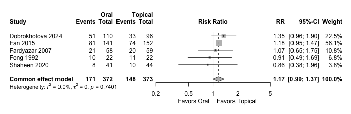
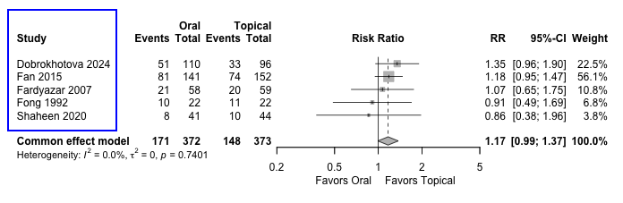
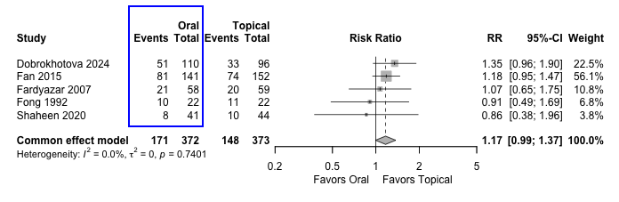
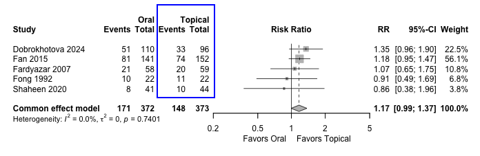
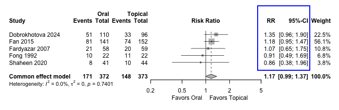
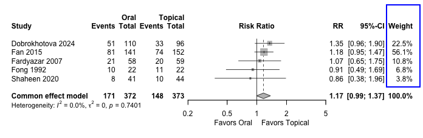
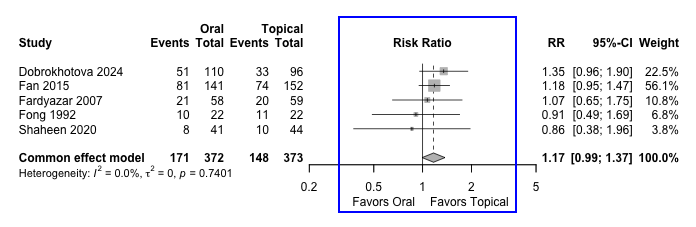
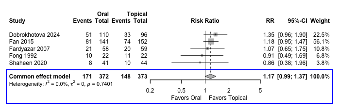
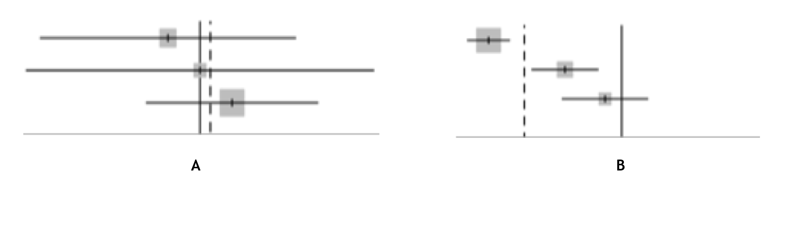
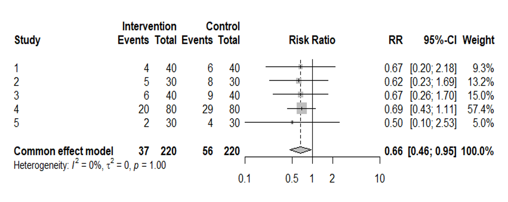

# Effect measures

## Types of outcome data

- **Dichotomous data**

- **Continuous data**

- **Time-to-event data**

## Dichotomous data

Summarizing data: risk \| odds

|                              | SSI \vspace{12pt} | No SSI \vspace{12pt} |
|:-----------------------------|:------------------|:---------------------|
| Preop Antibiotic Prophylaxis | 80                | 20 \vspace{24pt}     |
| No Antibiotic Prophylaxis    | 50                | 50                   |

## Dichotomous data

- Risk and odds are NOT identical

- Risk is expressed as a decimal number between 0 and 1 or as a percentage

- Odds is expressed as a ratio of two integers. It can be any value from 0 to infinity

## Dichotomous data

- Effect measures:

  - the risk ratio (RR)

  - the odds ratio (OR)

  - the risk difference (RD)

  - the number needed to treat (NNT)

## Continuous data

- Summarizing data: mean, SD

- Effect measures:

  - Difference in means

  - standardized mean difference

  - ratio of means

## Time-to-event data

- Summarizing data: hazard

- Effect measure: hazard ratio

## Measures of clinical tests accuracy

|                     | Disease \vspace{12pt} | No disease \vspace{12pt} |
|:--------------------|:----------------------|:-------------------------|
| Index test positive | TP                    | FP \vspace{24pt}         |
| Index test negative | FN                    | TN                       |

# The Plot Explained

## The outcome

- Recurrence of vulvovaginal candidiasis at the end of follow up

- A binary outcome

  - Numerical: point estimate (RR) for each study, then pooled summary (Weighted average).

  - Graphical: Forest plot

## The Plot

## The Plot

## The Plot

## The Plot

## The Plot

## The Plot

## The Plot

## The Plot

## Eyeballing to detect heterogeneity

## Trash synthesis

- In an era of perverse academic incentives, the publication of ***redundant***, ***flawed***, ***misleading***, ***conflicted*** synthesis of evidence

  - has reached epidemic proportions

  - is a major threat to

    - credible science

    - quality healthcare

## Trash synthesis

## Good Luck